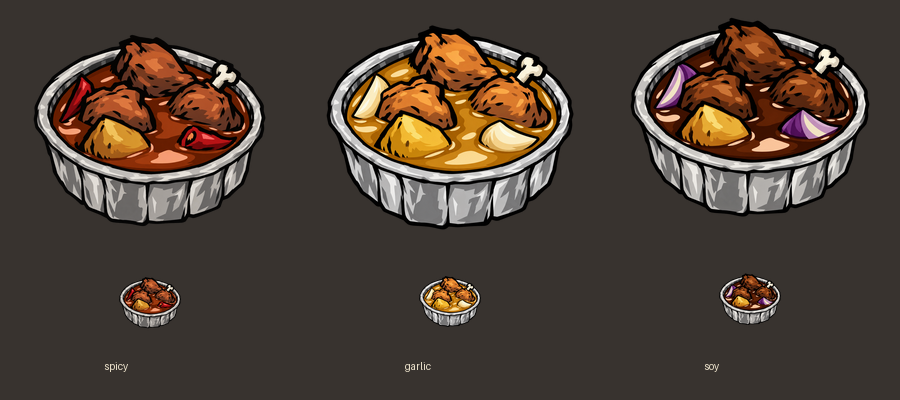

# 他二哥炒鸡 · Ta2BroFriedChicken

**永恒领域外卖开张！没有配送员，只有你和一口锅。**

作为作者最喜欢的外卖之一，这份炒鸡终于也能安排进饥荒了。
捡起鸟腿，掏出土豆，再决定今天是辣个痛快、蒜个明白，还是酱个踏实。
圆形锡纸盒里盛着浓浓酱汁，冒险可以狼狈，晚饭必须到位。



## 一锅怎么凑？

在四格烹饪锅里放入：

**生鸟腿 ≥ 1 ＋ 生土豆或生玉米 ≥ 1 ＋ 生辣椒、大蒜或洋葱 ≥ 1。**

第四格自由发挥：冰、胡萝卜、熟食等合法填充物都行；怪物肉也能来凑桌。
整锅不能有**非食度或甜味度**——树枝不入席，蜂蜜也先歇歇。

| 口味 | 生调味蔬菜 | 饱食 | 生命 | 精神 | 吃完的感受 |
| --- | --- | ---: | ---: | ---: | --- |
| 麻辣炒鸡 | 辣椒 | +75 | +60 | +30 | 辣得暖到心窝里，附带短时暖身 |
| 蒜香炒鸡 | 大蒜 | +75 | +60 | +40 | 蒜香一到，烦恼退散 |
| 酱香炒鸡 | 洋葱 | +75 | +60 | +15 | 浓汁拌鸡，踏实管饱 |

多种调味撞锅？按 **辣椒 ＞ 大蒜 ＞ 洋葱** 决定口味，绝不让锅纠结。
关键材料只认生的；熟食可以填格子，但不计入配方门槛，也不抢口味。
例如，生鸟腿＋生玉米＋生大蒜＋烤辣椒，得到的仍是蒜香炒鸡。

## 出餐须知

- 普通锅与沃利便携锅都能做，一锅一份，原版条件下均需 **20 秒**。
- 基础保鲜期 **10 个游戏日**；冰箱、季节、新鲜度和角色效果遵循原版规则。
- 麻辣采用原版食物暖身机制，温度参数 40、持续 15 秒，并非瞬间把体温加 40 度。
- 属于肉类料理，可堆叠、携带和保存，角色的食用限制照常生效。
- 配方优先级为 100；与其他 Mod 冲突时，按游戏的配方优先级机制结算。
- 本版不含沃利调味台加工版本，也没有额外配置菜单。

## 和朋友开饭

这是**服务器模组**，主机和所有加入的玩家都需要安装。
创意工坊发布后可通过订阅获取，联机时请保持版本一致。
手动安装请使用发布包，并在世界设置的服务器模组列表中启用「他二哥炒鸡」。

## 想先尝一口？

在测试世界的服务器端控制台执行：

```lua
c_give("ta2bro_chicken_spicy", 3)
c_give("ta2bro_chicken_garlic", 3)
c_give("ta2bro_chicken_soy", 3)
```

## 项目与素材

三款料理使用圆形锡纸盒、粗描边和简化色块，以红椒、蒜瓣、洋葱区分口味。
美术使用 AI 辅助创作；本项目为玩家制作的非官方 Mod。

开发者可运行以下命令构建资源、检查配方并生成发布包：

```sh
python -m pip install -r tools/requirements.txt
python tools/build_assets.py
python tools/test_mod.py
python tools/audit_release.py
python tools/package_mod.py
```

运行时只使用模组内部的相对资源引用，不依赖作者的游戏安装位置、系统用户名或个人配置。
工坊介绍文案见 [WORKSHOP_DESCRIPTION.bbcode](WORKSHOP_DESCRIPTION.bbcode)。
